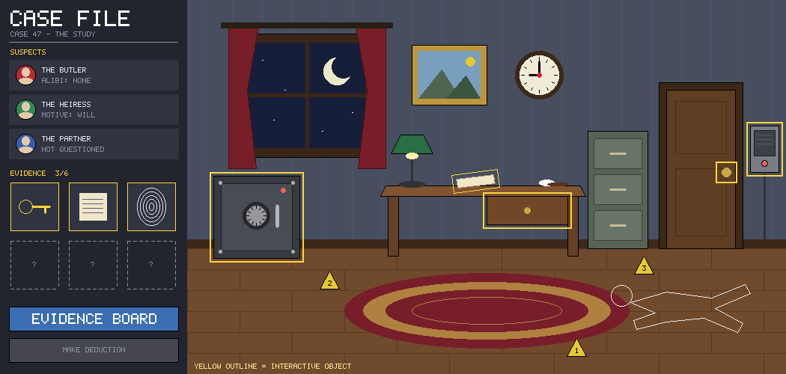
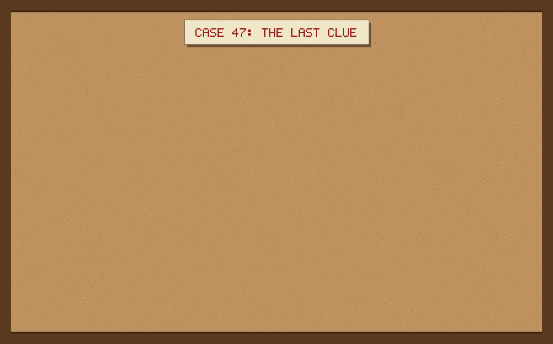

# The Last Clue

An interactive 2D detective puzzle game built for our Computer Graphics semester project. The player investigates a crime scene, solves graphical puzzles (a safe dial, a torn letter, an evidence board) and makes a final deduction: **who** did it, **how** and **why**. The graphics are the investigation tools: rotating the dial, moving and rotating torn pieces, and drawing strings between clues are all graphics operations.

Some locked areas, such as the safe's electronic lock and the security panel by the door, open only when the player **writes or fixes a short program** on the victim's computer. The game has its own tiny language, ClueScript, and an in-game code editor. The player's code **draws using our own algorithms** (Bresenham, midpoint circle and ellipse, rotation), and the game checks the drawing to decide whether the lock opens. This is planned for CP3 and the final project; see [`docs/design/code-puzzles.md`](docs/design/code-puzzles.md).

**Status (Checkpoint 2):** every algorithm covered so far, plus **transformations and animation**, is implemented in **pure C++** and applied to components of the game. Each shape is produced by our own code writing individual pixels to a `Canvas`, and every animation is saved by our own GIF encoder. No graphics library is used.





## Group members and responsibilities

| Member | GitHub | Role | Checkpoint 1 work | Checkpoint 2 work |
|---|---|---|---|---|
| Caleb Kipchirchir | [@C-Sawe](https://github.com/C-Sawe) | Graphics & Algorithms | Canvas + BMP writer, bitmap font, DDA & Bresenham lines, midpoint circle & ellipse, 2D transformation matrices, integration | Shear and reflection, our own animated GIF encoder (palette + LZW), CP2 integration |
| Alvin Kimani | [@alvviinn](https://github.com/alvviinn) | Environment & Visual Design | Polygon representation, scanline fill (edge table / active edge table), flood & boundary fill, crime scene, character line-up | Detective walk cycle (hierarchical limb rotation, sprite scaling), door/drawer opening animations |
| Sudheysi Ali | [@Satasdin](https://github.com/Satasdin) | Puzzles & Game Mechanics | Cohen–Sutherland line clipping, Sutherland–Hodgman polygon clipping, point-in-polygon, safe dial, torn document puzzle, clipping/magnifier demo | Safe combination + door opening, torn letter reassembling, magnifier zoom |
| Latiffa | [@latifahjaafar](https://github.com/latifahjaafar) | Interface, Animation & Integration | Bézier curves (de Casteljau), Catmull-Rom splines, evidence board, Case File panel, documentation and submission | Animation core (lerp, easing, keyframes), evidence board animation, scene transitions |

## Technologies and tools

- **C++17**: all graphics code, with no graphics library
- **CMake 3.10+**: build system (works with g++, clang++ and MSVC)
- **Git & GitHub**: branches per member, issues, milestones and pull requests
- **Output:** 24-bit BMP images and animated GIFs, both written by our own encoders (`src/core/canvas.cpp`, `src/core/gif.cpp`)
- **Later checkpoints:** OpenGL (CP3), once it is introduced in class

## Graphics techniques implemented so far

| Technique | Algorithm | Where it is used in the game | Code | Status |
|---|---|---|---|---|
| Line drawing | DDA, Bresenham (all 8 octants), thick lines | Evidence strings, wires, every outline | `src/primitives/line.cpp` | ✅ |
| Circles | Midpoint circle, 8-way symmetry, filled spans | Safe dial, board pins, clock, buttons | `src/primitives/circle.cpp` | ✅ |
| Ellipses | Midpoint ellipse (regions 1 and 2), filled | Heads, rug, shoes, fingerprint ridges | `src/primitives/ellipse.cpp` | ✅ |
| Polygons | Ordered vertex list, rectangles, regular polygons, stars | Furniture, coats, torn paper pieces | `src/polygon/polygon.cpp` | ✅ |
| Polygon filling | Scanline fill with edge table + active edge table | All filled shapes (convex and concave) | `src/polygon/fill.cpp` | ✅ |
| Seed filling | Flood fill and boundary fill (4-connected, explicit stack) | Region colouring | `src/polygon/fill.cpp` | ✅ |
| Line clipping | Cohen–Sutherland (outcodes) | Strings clipped to the viewport | `src/polygon/clip.cpp` | ✅ |
| Polygon clipping | Sutherland–Hodgman | Furniture clipped to the viewport | `src/polygon/clip.cpp` | ✅ |
| Hit testing | Point in polygon (ray casting, even-odd) | Torn pieces; mouse picking later | `src/polygon/clip.cpp` | ✅ |
| Bézier curves | de Casteljau (any degree) | Sagging evidence strings | `src/curves/bezier.cpp` | ✅ |
| Splines | Catmull-Rom (passes through every point) | Handwriting and signatures | `src/curves/spline.cpp` | ✅ |
| 2D transforms | 3×3 homogeneous matrices: translate, rotate/scale about a pivot, composite, inverse | Safe dial, document pieces, arms, magnifier | `src/transform/transform2d.cpp` | ✅ |
| Shear and reflection *(CP2)* | Shear matrix, reflection in any line: T(p)·R(a)·S(1,−1)·R(−a)·T(−p) | Door swinging open (fake perspective), card flip | `src/transform/transform2d.cpp` | ✅ |
| Interpolation and easing *(CP2)* | lerp for numbers, points and colours; Linear, Quad, Cubic, Back, Bounce easing | Every animation | `src/animation/animation.cpp` | ✅ |
| Keyframe animation *(CP2)* | Keyframe tracks sampled at any time, staggered phases | Safe combination, opening sequence | `src/animation/animation.cpp` | ✅ |
| Hierarchical transforms *(CP2)* | Limbs rotate about joints, attached parts follow | Detective walk cycle | `src/scenes/characters.cpp` | ✅ |
| Raster transforms *(CP2)* | Inverse mapping: each destination pixel looks up its source through inverse(M) | Sprite scaling, safe door, magnifier zoom, letter pieces | `characters.cpp`, `safe.cpp`, `magnifier.cpp`, `document.cpp` | ✅ |
| Transitions *(CP2)* | Cross-fade and fade through black (colour lerp), wipe (clip window), iris (circle) | Moving between scenes | `src/animation/transitions.cpp` | ✅ |
| GIF encoding *(CP2)* | Palette building + LZW compression (9–12-bit codes) | Saving every animation | `src/core/gif.cpp` | ✅ |

## Screenshots

| | |
|---|---|
|  **Crime scene:** polygons, fills, circles, ellipses |  **Characters:** ellipses, rotated polygons, circles |
|  **Evidence board:** Bézier strings, Catmull-Rom handwriting |  **Torn letter:** polygon pieces + inverse transform mapping |
|  **Safe dial:** circles + rotation about a pivot |  **Clipping:** viewport and magnifier |

### Animations (Checkpoint 2)

| | |
|---|---|
|  **Walk cycle:** hierarchical rotation + sprite scaling |  **Door and drawers:** shear + scale about hinges |
|  **Safe:** dial keyframes 37-12-85, door swings open |  **Torn letter:** interpolated rotate + translate |
|  **Magnifier:** scale about the focus, clipped |  **Transitions:** wipe, iris, fades |
|  **Easing functions + keyframes** |  **Reflection/shear:** card flip |

Key frames from every animation are collected with captions in [`docs/checkpoint2_animations.pdf`](docs/checkpoint2_animations.pdf).

The algorithm test sheets (`01`–`09`) are in [`docs/screenshots/`](docs/screenshots), and every image is collected with captions in [`docs/checkpoint1_screenshots.pdf`](docs/checkpoint1_screenshots.pdf).

## Project structure

```
src/core/        Canvas (pixel buffer), Color/Point types, BMP writer, 5x7 bitmap font
src/primitives/  lines, circles, ellipses
src/polygon/     polygon representation, filling, clipping, point-in-polygon
src/core/gif.*   our own animated GIF encoder
src/curves/      Bézier and Catmull-Rom
src/transform/   2D transformation matrices (incl. shear, reflection)
src/animation/   interpolation, easing, keyframe tracks, scene transitions
src/scenes/      game components built from the algorithms above
demos/           one program per demo; each writes an image (and, from 17 on, a GIF) to output/
scripts/         render_all.sh, GitHub setup scripts
docs/            screenshots, checkpoint PDFs, design documents (docs/design/)
```

## How to compile and run

You need CMake and a C++17 compiler (g++/MinGW, clang/Xcode tools or Visual Studio).

```bash
git clone https://github.com/C-Sawe/the-last-clue.git
cd the-last-clue
bash scripts/render_all.sh        # builds everything and runs every demo
```

Or build and run a single demo:

```bash
cmake -B build -S .
cmake --build build
./build/10_crime_scene             # Windows (Visual Studio): build\Debug\10_crime_scene.exe
```

Run demos from the **repository root**. The images appear in `output/` and open in any image viewer. Animation demos write a `.gif` (open it in a browser) plus a `.bmp` sheet of four key frames.

| Demo | Shows |
|---|---|
| `01_lines` … `09_transforms` | One test sheet per algorithm |
| `10_crime_scene`, `11_characters` | Environment and characters |
| `12_safe_dial`, `13_torn_document`, `14_clipping_scene` | Puzzles and clipping |
| `15_evidence_board`, `16_full_layout` | Evidence board and the full game window |
| `17_shear_reflect` | Shear and reflection (+ `17_card_flip.gif`) |
| `18_easing` | Easing curves (+ `18_easing_race.gif`) |
| `19_board_animation`, `20_transitions` | Evidence board animation, scene transitions |
| `21_walk_cycle`, `22_opening` | Detective walking, door and drawers opening |
| `23_safe_animation`, `24_document_animation`, `25_magnifier_zoom` | Puzzle animations |

## Current progress

- [x] **Checkpoint 1 (Technical Foundation):** all algorithms covered so far, applied to game components
- [x] **Checkpoint 2 (Transformation & Animation, week 10):** shear/reflection, animation core (easing, keyframes), our own GIF encoder, walk cycle, opening animations, safe/letter/magnifier animations, scene transitions
- [ ] **Checkpoint 3 (OpenGL + Prototype, week 12):** window and input, mouse picking, playable investigation loop, ClueScript interpreter + in-game code editor + first code puzzle
- [ ] **Final project (week 13):** deduction, 4–6 puzzles (including code puzzles: security wiring, encrypted email), polish

Progress is tracked in [Issues](https://github.com/C-Sawe/the-last-clue/issues) and [Milestones](https://github.com/C-Sawe/the-last-clue/milestones).

## Planned feature: code puzzles

| Part | Technique | Milestone |
|---|---|---|
| ClueScript interpreter (lexer → recursive-descent parser → AST → tree-walking evaluator, step limit) | Pure C++ | CP3 |
| Player's drawing commands (`line`, `circle`, `forward`/`turn` turtle) | Bresenham, midpoint circle/ellipse, rotation of the heading vector | CP3 |
| Output clipped to the in-game monitor | Cohen–Sutherland, Sutherland–Hodgman | CP3 |
| Checking the answer | Rasterised IoU comparison; point-in-polygon + segment intersection for wiring | CP3 / Final |
| In-game code editor | Bitmap font, keyboard input, RUN/RESET, error console | CP3 |
| Lock opens | Door/safe opening animation (transforms over time) | CP2 → CP3 |

The full design is in [`docs/design/code-puzzles.md`](docs/design/code-puzzles.md), and the work is tracked under the [`code-puzzle`](https://github.com/C-Sawe/the-last-clue/issues?q=label%3Acode-puzzle) label.

## Known limitations

- Animations are pre-rendered to GIF files. There is no window or mouse input yet; those come in CP3 with OpenGL.
- The GIF palette is limited to 256 colours across an animation (enough for our flat-colour art, but gradients would band).
- The detective is drawn facing the front, so the walk is shown as alternating steps rather than a side-on stride.
- Text uses our own 5×7 bitmap font, so it is upper-case only and has no anti-aliasing.
- Lines, circles and curves are aliased (no anti-aliasing).
- Rotated text is not supported: the labels on the safe dial move with the dial, but the characters stay upright.
- Still images are BMP, so screenshots were converted to PNG for this README.

## Contributing workflow

1. Work on **your own branch** (`caleb`, `alvin`, `sudheysi`, `latiffa`). Run `git pull origin main` before starting.
2. Commit small and often, referencing the issue: `git commit -m "Add scanline fill (#12)"`.
3. Open a pull request into `main` with `Closes #N`, and ask a teammate to review it.
4. Make sure `git config user.email` matches your GitHub email, so that your commits count toward you.
