# The Last Clue

An interactive 2D detective puzzle game built for our Computer Graphics semester project. The player investigates a crime scene, solves **six puzzles** and makes a final deduction: **who** did it, **how** and **why**. The graphics are the investigation tools: rotating the dial, moving and rotating torn pieces, turning a fingerprint until its ridges line up, and drawing strings between clues are all graphics operations.

Three of the locks open only when the player **writes or fixes a short program**: the safe's alarm, the security panel that powers the study door, and the victim's scrambled email. The game has its own tiny language, ClueScript, and an in-game code editor. The player's code **draws using our own algorithms** (Bresenham, midpoint circle and ellipse, rotation), and the game checks the result to decide whether the lock opens (see [`docs/design/code-puzzles.md`](docs/design/code-puzzles.md)).

**Status (final project):** the whole case is **playable from start to finish** in an OpenGL window, with a win (CASE SOLVED) and a lose (CASE FAILED) ending. Every frame is drawn by **our own C++ algorithms** into a `Canvas`; OpenGL displays it as a texture and draws the hover outlines with its own primitives, and GLFW provides the window, mouse and keyboard.

- **Demo video:** [`docs/demo_video.mp4`](docs/demo_video.mp4) (1 min 40 s, the whole case with captions)
- **Final report:** [`docs/final_report.pdf`](docs/final_report.pdf)

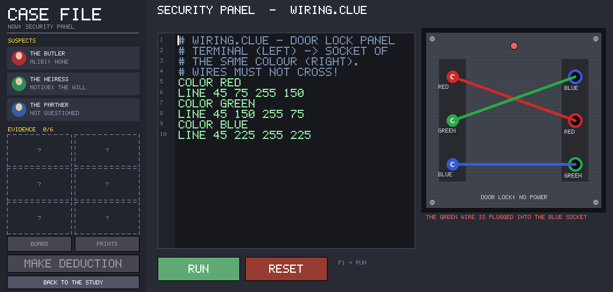

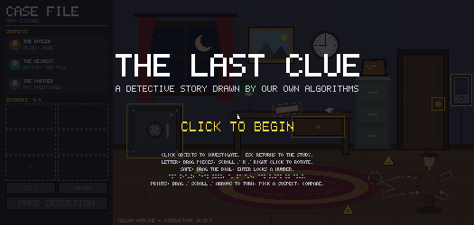

## Group members and responsibilities

| Member | GitHub | Role | Checkpoint 1 work | Checkpoint 2 work | Checkpoint 3 work | Final project work |
|---|---|---|---|---|---|---|
| Caleb Kipchirchir | [@C-Sawe](https://github.com/C-Sawe) | Graphics & Algorithms | Canvas + BMP writer, bitmap font, DDA & Bresenham lines, midpoint circle & ellipse, 2D transformation matrices, integration | Shear and reflection, our own animated GIF encoder (palette + LZW), CP2 integration | GLFW window + render loop, Canvas→OpenGL texture bridge, ClueScript interpreter, prototype integration | Final integration of all six puzzles and both endings, play again, toast and screen transitions, full scripted playthrough + video recording, bug bash, v1.0 |
| Alvin Kimani | [@alvviinn](https://github.com/alvviinn) | Environment & Visual Design | Polygon representation, scanline fill (edge table / active edge table), flood & boundary fill, crime scene, character line-up | Detective walk cycle (hierarchical limb rotation, sprite scaling), door/drawer opening animations | Playable crime scene: hotspots, detective walks to objects, laptop, painting close-up | Fingerprint art (ellipse ridges: whorl, loop, arch), security panel + wiring board, back room + vial, shared feedback/evidence palette, new hotspots and door rules |
| Sudheysi Ali | [@Satasdin](https://github.com/Satasdin) | Puzzles & Game Mechanics | Cohen–Sutherland line clipping, Sutherland–Hodgman polygon clipping, point-in-polygon, safe dial, torn document puzzle, clipping/magnifier demo | Safe combination + door opening, torn letter reassembling, magnifier zoom | Game state machine, mouse picking/dragging, interactive letter + safe puzzles, code-puzzle checking (IoU) | Code puzzles A (wiring: point-in-polygon + segment intersection) and C (Caesar-shift email), fingerprint matching (rotated IoU), deduction rules and the three-tries lose condition |
| Latiffa | [@latifahjaafar](https://github.com/latifahjaafar) | Interface, Animation & Integration | Bézier curves (de Casteljau), Catmull-Rom splines, evidence board, Case File panel, documentation and submission | Animation core (lerp, easing, keyframes), evidence board animation, scene transitions | Text layout + buttons, in-game code editor and laptop, live Case File, interactive evidence board | Multi-file code terminal (tabs, puzzle backgrounds, text output), deduction screen, CASE SOLVED / FAILED sequences, evidence pop + sliding toast, final README, report and demo video |

## Technologies and tools

- **C++17**: all graphics code, with no graphics library
- **CMake 3.14+**: build system (works with g++, clang++ and MSVC)
- **Git & GitHub**: branches per member, issues, milestones and pull requests
- **Output:** 24-bit BMP images and animated GIFs, both written by our own encoders (`src/core/canvas.cpp`, `src/core/gif.cpp`)
- **OpenGL + GLFW (CP3):** OpenGL displays our Canvas as a texture and draws vector overlays (`GL_LINE_LOOP`); GLFW gives the window, mouse and keyboard. GLFW is used if installed, otherwise CMake downloads it automatically.

## Graphics techniques implemented

| Technique | Algorithm | Where it is used in the game | Code | Status |
|---|---|---|---|---|
| Line drawing | DDA, Bresenham (all 8 octants), thick lines | Evidence strings, wires, every outline | `src/primitives/line.cpp` | ✅ |
| Circles | Midpoint circle, 8-way symmetry, filled spans | Safe dial, board pins, clock, buttons | `src/primitives/circle.cpp` | ✅ |
| Ellipses | Midpoint ellipse (regions 1 and 2), filled | Heads, rug, shoes, fingerprint ridges | `src/primitives/ellipse.cpp` | ✅ |
| Polygons | Ordered vertex list, rectangles, regular polygons, stars | Furniture, coats, torn paper pieces | `src/polygon/polygon.cpp` | ✅ |
| Polygon filling | Scanline fill with edge table + active edge table | All filled shapes (convex and concave) | `src/polygon/fill.cpp` | ✅ |
| Seed filling | Flood fill and boundary fill (4-connected, explicit stack) | Region colouring | `src/polygon/fill.cpp` | ✅ |
| Line clipping | Cohen–Sutherland (outcodes) | Strings clipped to the viewport | `src/polygon/clip.cpp` | ✅ |
| Polygon clipping | Sutherland–Hodgman | Furniture clipped to the viewport | `src/polygon/clip.cpp` | ✅ |
| Hit testing | Point in polygon (ray casting, even-odd) | Torn pieces; mouse picking later | `src/polygon/clip.cpp` | ✅ |
| Bézier curves | de Casteljau (any degree) | Sagging evidence strings | `src/curves/bezier.cpp` | ✅ |
| Splines | Catmull-Rom (passes through every point) | Handwriting and signatures | `src/curves/spline.cpp` | ✅ |
| 2D transforms | 3×3 homogeneous matrices: translate, rotate/scale about a pivot, composite, inverse | Safe dial, document pieces, arms, magnifier | `src/transform/transform2d.cpp` | ✅ |
| Shear and reflection *(CP2)* | Shear matrix, reflection in any line: T(p)·R(a)·S(1,−1)·R(−a)·T(−p) | Door swinging open (fake perspective), card flip | `src/transform/transform2d.cpp` | ✅ |
| Interpolation and easing *(CP2)* | lerp for numbers, points and colours; Linear, Quad, Cubic, Back, Bounce easing | Every animation | `src/animation/animation.cpp` | ✅ |
| Keyframe animation *(CP2)* | Keyframe tracks sampled at any time, staggered phases | Safe combination, opening sequence | `src/animation/animation.cpp` | ✅ |
| Hierarchical transforms *(CP2)* | Limbs rotate about joints, attached parts follow | Detective walk cycle | `src/scenes/characters.cpp` | ✅ |
| Raster transforms *(CP2)* | Inverse mapping: each destination pixel looks up its source through inverse(M) | Sprite scaling, safe door, magnifier zoom, letter pieces | `characters.cpp`, `safe.cpp`, `magnifier.cpp`, `document.cpp` | ✅ |
| Transitions *(CP2)* | Cross-fade and fade through black (colour lerp), wipe (clip window), iris (circle) | Moving between scenes | `src/animation/transitions.cpp` | ✅ |
| GIF encoding *(CP2)* | Palette building + LZW compression (9–12-bit codes) | Saving every animation | `src/core/gif.cpp` | ✅ |
| OpenGL display *(CP3)* | Canvas uploaded as a texture each frame, letterboxed textured quad, orthographic projection; GL_LINE_LOOP overlays | The game window | `src/platform/gl_canvas.cpp` | ✅ |
| Game loop *(CP3)* | Fixed time step (accumulator), input events translated to canvas coordinates | The game window | `src/platform/window_app.cpp` | ✅ |
| Picking and dragging *(CP3)* | Point-in-polygon on transformed shapes, grab offset, boundary clamping, dial angle via atan2 | Hotspots, letter pieces, safe dial, board cards | `src/game/input.cpp`, `puzzles.cpp` | ✅ |
| Snapping *(CP3)* | Position + angle tolerance, then jump to the exact pose | Torn letter pieces | `src/game/puzzles.cpp` | ✅ |
| Interpreter *(CP3)* | Lexer → recursive-descent parser → AST → tree-walking evaluator with a step limit; turtle heading uses the rotation matrix | ClueScript code puzzle | `src/script/` | ✅ |
| Answer checking *(CP3)* | Rasterise both drawings with thick lines, Intersection over Union ≥ 0.85 | The safe's alarm (code puzzle) | `src/game/code_check.cpp` | ✅ |
| Monospace text editing *(CP3)* | Row/column ↔ pixel arithmetic on the font grid, word wrap | Code editor, Case File | `src/ui/` | ✅ |
| Segment intersection *(final)* | Orientation (cross-product sign) test, plus collinear-overlap cases | Wiring puzzle: no two wires may cross | `src/game/code_check.cpp` | ✅ |
| Wire tracing *(final)* | Lines grouped by colour, followed from the terminal; the end is tested with point-in-polygon on the socket | Wiring puzzle | `src/game/code_check.cpp` | ✅ |
| Caesar shift *(final)* | `shift` command in ClueScript: modular arithmetic on letters | Encrypted email puzzle | `src/script/interpreter.cpp` | ✅ |
| Fingerprint ridges *(final)* | Concentric midpoint ellipses shaped into whorl / loop / arch; point-in-ellipse finger mask | Suspect prints, lifted print | `src/scenes/fingerprint.cpp` | ✅ |
| Rotated matching *(final)* | Inverse-mapped rotation of the lifted print, thickened ink masks, IoU ≥ 0.53 | Fingerprint puzzle | `src/game/puzzles.cpp` | ✅ |
| Stamp animation *(final)* | Text rendered to its own canvas, then scaled 3×→1× (OutBack) and rotated by inverse mapping; shake on impact | CASE SOLVED / FAILED | `src/ui/deduction_ui.cpp` | ✅ |
| Vanishing-point scaling *(final)* | Figure scaled down about a point on the horizon as it moves towards it | The culprit walking free (CASE FAILED) | `src/ui/deduction_ui.cpp` | ✅ |
| Feedback animation *(final)* | Evidence slot pops in (scale about its centre, OutBack), sliding toast, staggered card drops, eased card lift | Case File, deduction, every message | `src/ui/` | ✅ |

## Screenshots

### Final game

| | |
|---|---|
|  **Security panel (code puzzle A):** the wires are a program | 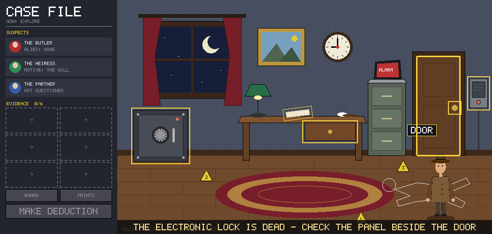 **The study:** panel beside the door, alarm LED, OpenGL hover outline |
| 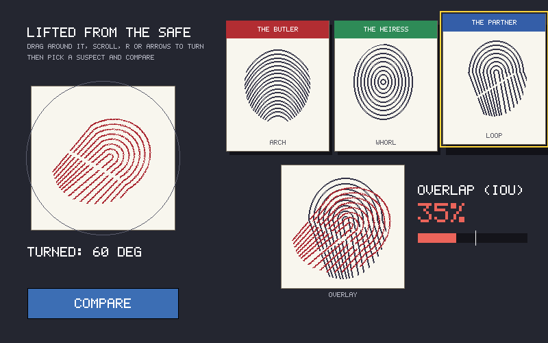 **Fingerprints:** turn the lifted print, IoU overlap | 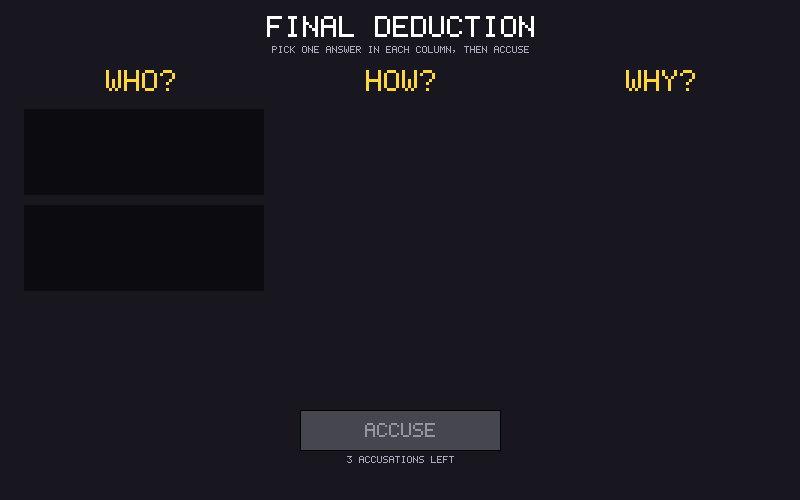 **Deduction → CASE SOLVED** |
| 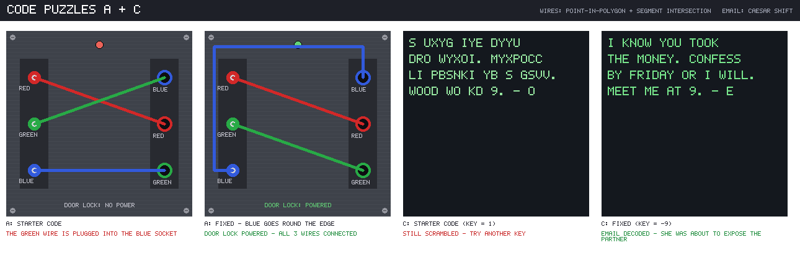 **Code puzzles A + C:** starter code vs fixed | 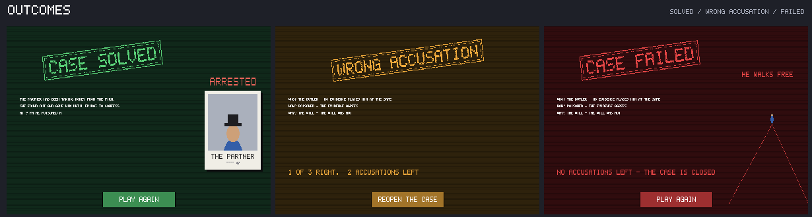 **Outcomes:** solved, wrong accusation, failed |
| 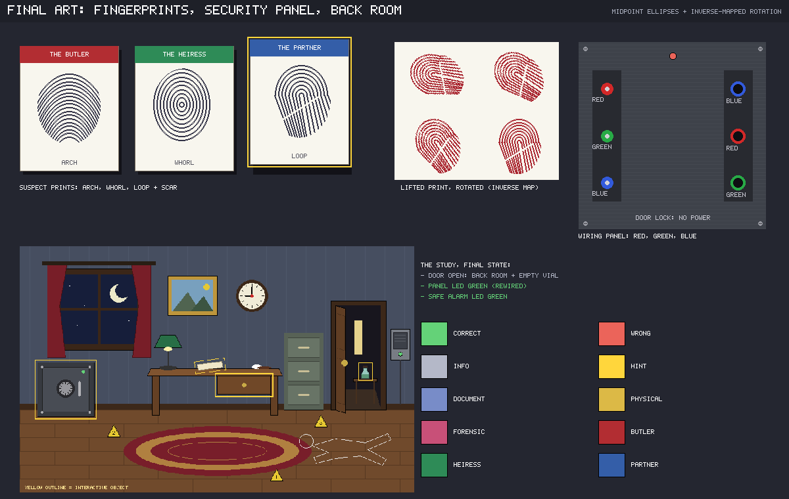 **Final art:** prints, wiring board, back room, palette | 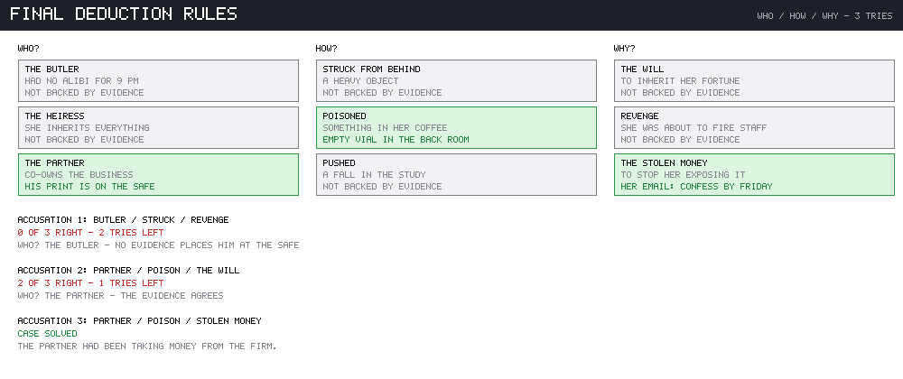 **Deduction rules:** evidence behind each answer |

### Checkpoint 1

| | |
|---|---|
| 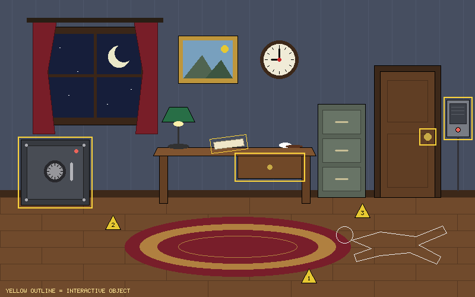 **Crime scene:** polygons, fills, circles, ellipses | 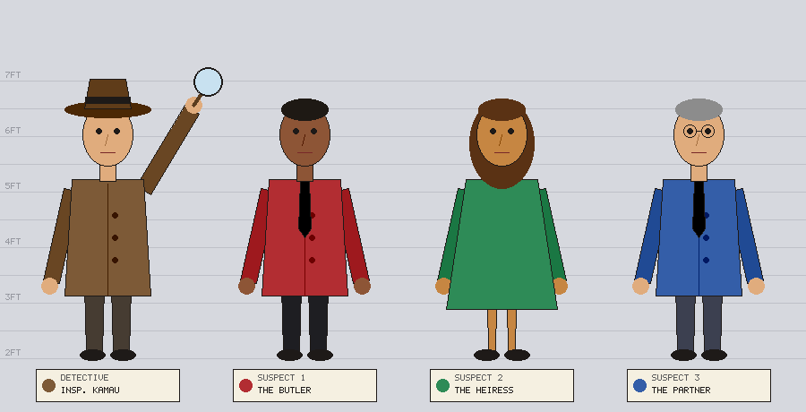 **Characters:** ellipses, rotated polygons, circles |
| 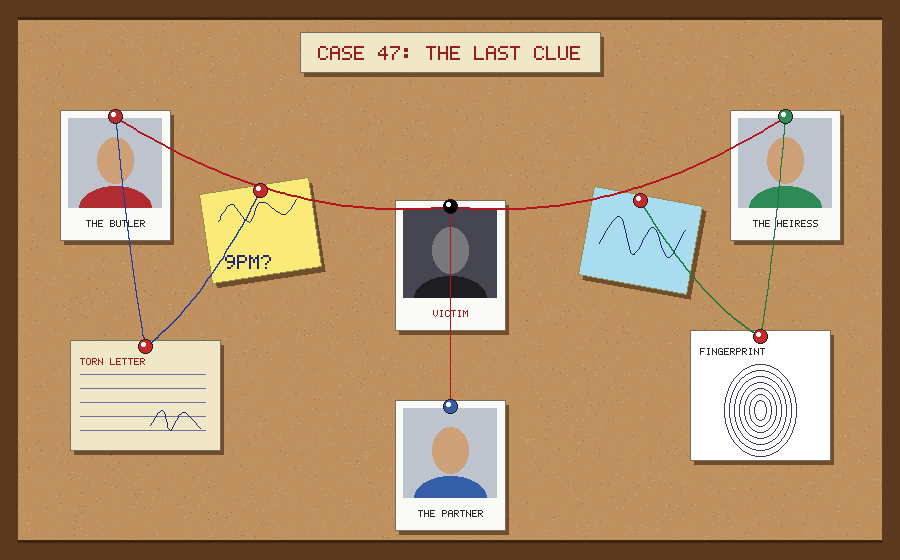 **Evidence board:** Bézier strings, Catmull-Rom handwriting | 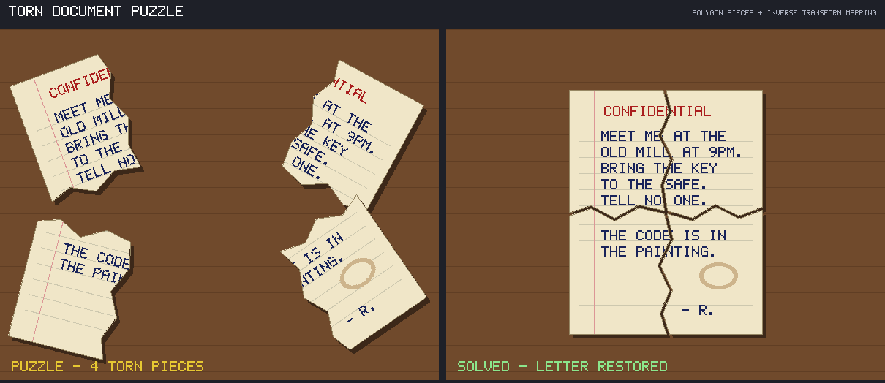 **Torn letter:** polygon pieces + inverse transform mapping |
| 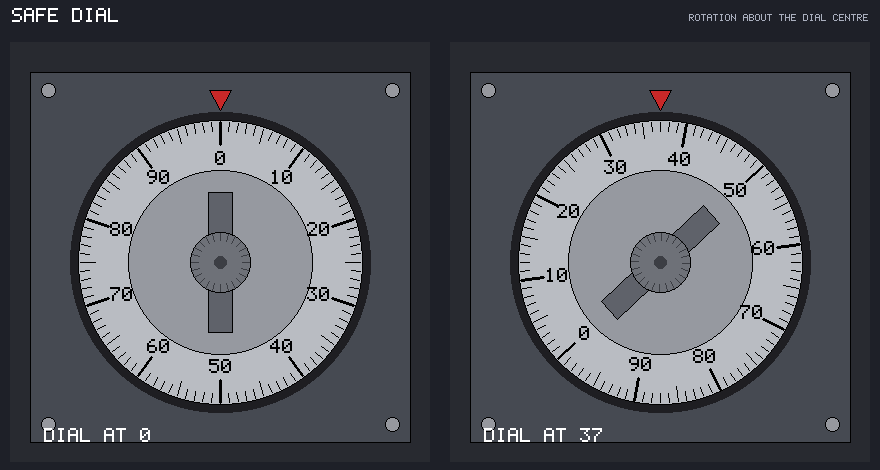 **Safe dial:** circles + rotation about a pivot | 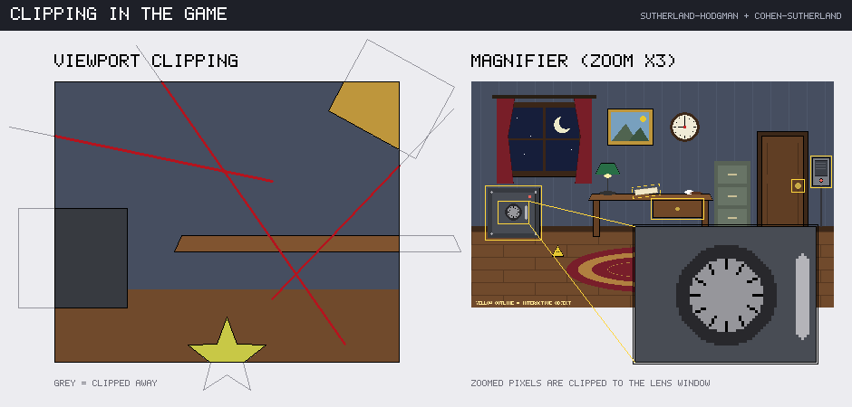 **Clipping:** viewport and magnifier |

### Playable prototype (Checkpoint 3)

| | |
|---|---|
| 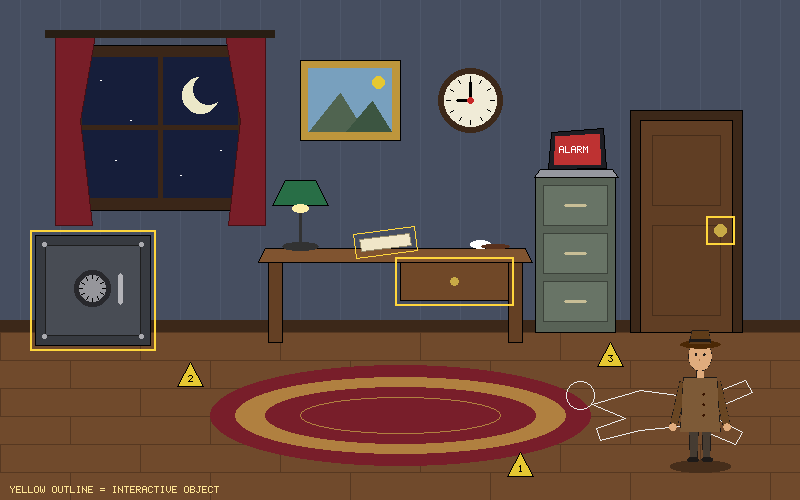 **Explore:** hover tags, detective walks to the drawer | 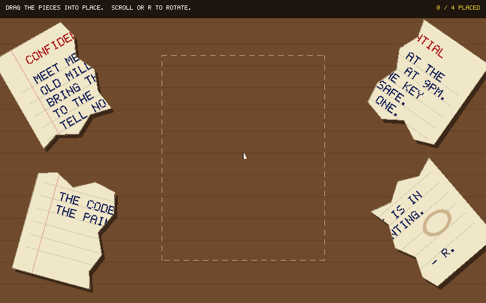 **Puzzles:** drag + rotate + snap; dial dragging |
| 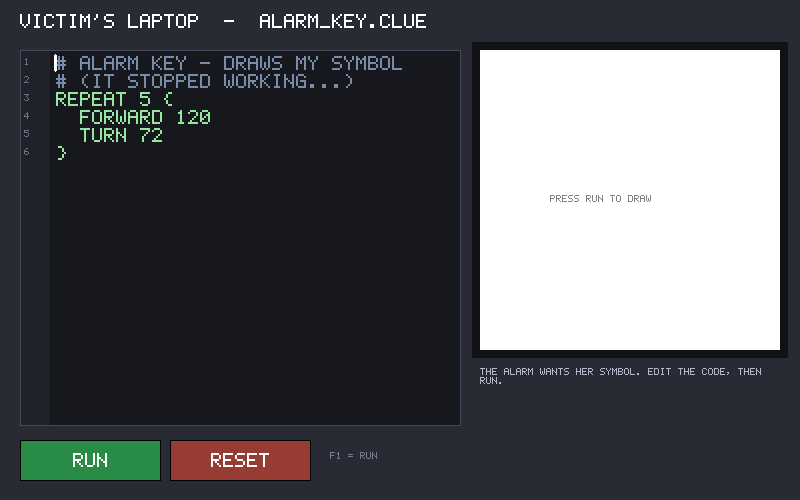 **Code puzzle:** fix the program, RUN, IoU check | 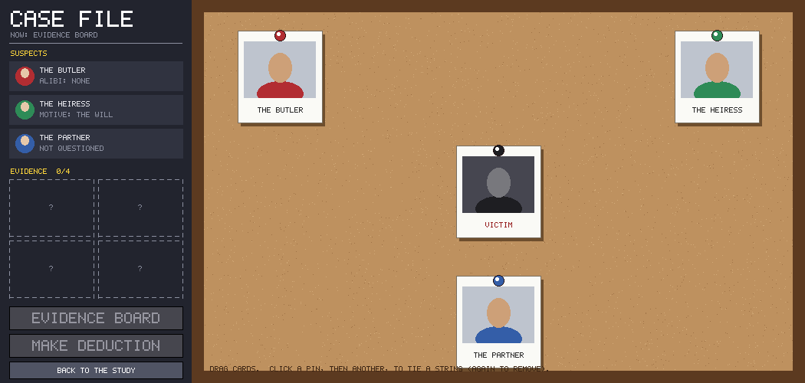 **Evidence board:** drag cards, tie strings |
| 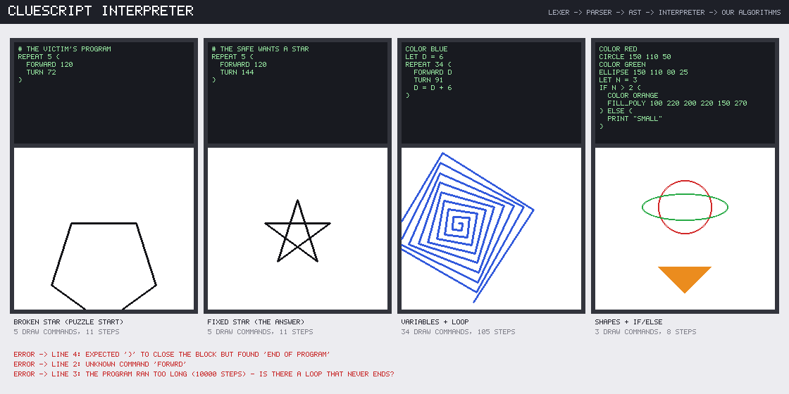 **ClueScript interpreter** | 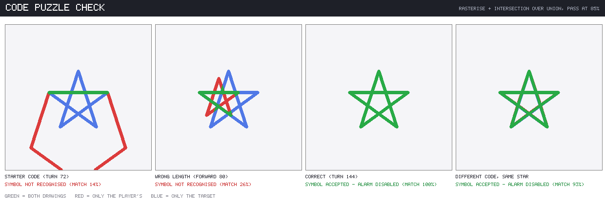 **Answer check:** IoU against the target |

Screenshots of the real OpenGL window and key frames of every CP3 demo are collected in [`docs/checkpoint3_prototype.pdf`](docs/checkpoint3_prototype.pdf).

### Animations (Checkpoint 2)

| | |
|---|---|
| 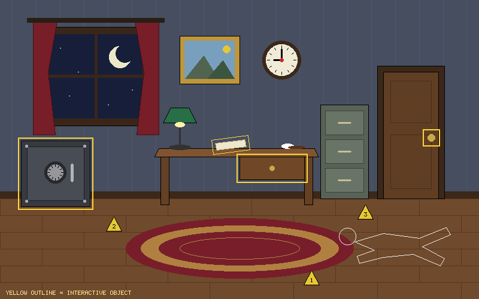 **Walk cycle:** hierarchical rotation + sprite scaling |  **Door and drawers:** shear + scale about hinges |
| 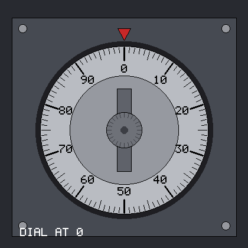 **Safe:** dial keyframes 37-12-85, door swings open | 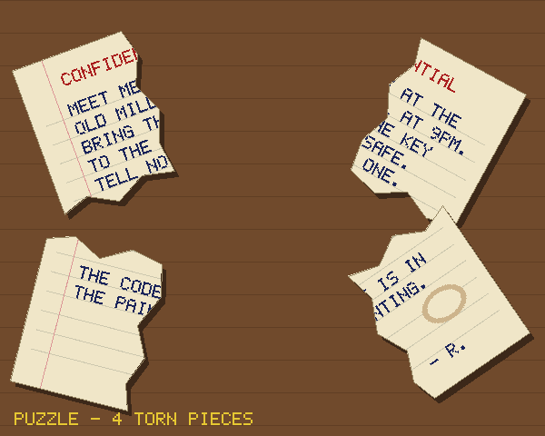 **Torn letter:** interpolated rotate + translate |
| 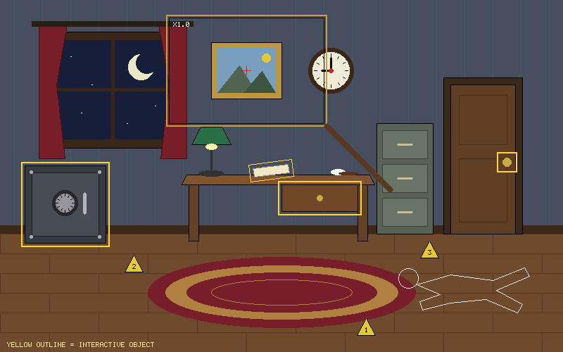 **Magnifier:** scale about the focus, clipped | 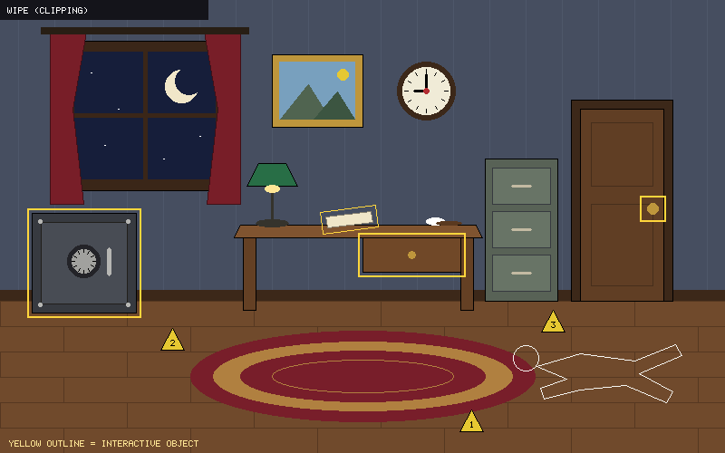 **Transitions:** wipe, iris, fades |
| 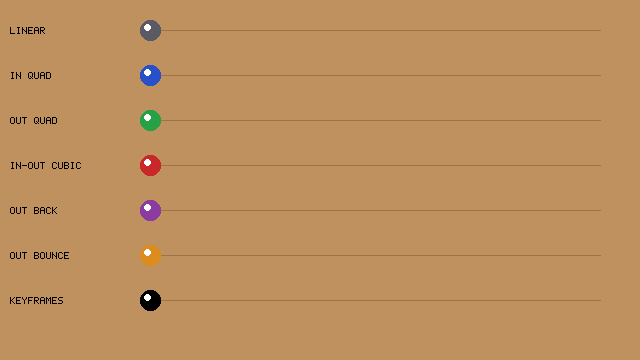 **Easing functions + keyframes** | 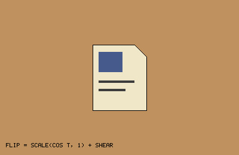 **Reflection/shear:** card flip |

Key frames from every animation are collected with captions in [`docs/checkpoint2_animations.pdf`](docs/checkpoint2_animations.pdf).

The algorithm test sheets (`01`–`09`) are in [`docs/screenshots/`](docs/screenshots), and every image is collected with captions in [`docs/checkpoint1_screenshots.pdf`](docs/checkpoint1_screenshots.pdf).

## Project structure

```
src/core/        Canvas (pixel buffer), Color/Point types, BMP writer, 5x7 bitmap font
src/primitives/  lines, circles, ellipses
src/polygon/     polygon representation, filling, clipping, point-in-polygon
src/core/gif.*   our own animated GIF encoder
src/curves/      Bézier and Catmull-Rom
src/transform/   2D transformation matrices (incl. shear, reflection)
src/animation/   interpolation, easing, keyframe tracks, scene transitions
src/scenes/      game components built from the algorithms above
src/script/      ClueScript: lexer, parser, AST, interpreter, drawing (CP3)
src/game/        game state, picking/dragging, puzzles, explore screen, Game (CP3)
src/ui/          text helpers, code editor + laptop, Case File, evidence board (CP3)
src/platform/    GLFW window + loop, Canvas->OpenGL bridge (the only code that uses GLFW/OpenGL)
apps/            windowed programs: the_last_clue (the game), scene_viewer
demos/           one program per demo; each writes an image (and, from 17 on, a GIF) to output/
scripts/         render_all.sh, GitHub setup scripts
docs/            screenshots, checkpoint PDFs, design documents (docs/design/)
```

## How to compile and run

You need CMake and a C++17 compiler (g++/MinGW, clang/Xcode tools or Visual Studio).

```bash
git clone https://github.com/C-Sawe/the-last-clue.git
cd the-last-clue
bash scripts/render_all.sh        # builds everything and runs every demo
```

Or build and run a single demo:

```bash
cmake -B build -S .
cmake --build build
./build/10_crime_scene             # Windows (Visual Studio): build\Debug\10_crime_scene.exe
```

### Play the game

```bash
cmake -B build -S .
cmake --build build
./build/the_last_clue              # Windows (Visual Studio): build\Debug\the_last_clue.exe
```

The first configure downloads GLFW if it is not installed (internet needed once). On Linux, install `libglfw3-dev` (or the X11 development packages) first. To build only the image demos, without a window: `cmake -B build -S . -DLASTCLUE_GAME=OFF`.

**Controls:** click objects to investigate (the detective walks there) · **Esc** returns to the study · torn letter: drag pieces, **scroll / R / right-click** to rotate · safe: drag the dial, **Enter** locks a number, **←/→** fine-tune · terminals (laptop, security panel): type to edit, **RUN** or **F1**, **Tab** switches file · fingerprints: drag around the print, **scroll / R / ←→** to turn, pick a suspect, **COMPARE** · evidence board: drag cards, click two pins to tie a string · deduction: pick one card per column, **ACCUSE**.

**The six puzzles:**

| # | Puzzle | Opens / gives | Graphics behind it |
|---|---|---|---|
| 1 | Torn letter | "The code is in the painting" | Drag + rotate + snap (transforms, point-in-polygon) |
| 2 | Safe alarm (code B) | Turns the alarm off, unlocks MAIL.CLUE | ClueScript turtle star, rasterised IoU ≥ 0.85 |
| 3 | Safe dial 37-12-85 | Door key + fingerprint | atan2 dial dragging, door swings open |
| 4 | Security panel (code A) | Powers the study door's lock | Wire tracing, point-in-polygon, segment intersection |
| 5 | Encrypted email (code C) | The motive | Caesar shift in ClueScript, text check |
| 6 | Fingerprints | Who touched the safe | Rotated IoU of ellipse-ridge prints |

**Walkthrough** *(spoilers)*: drawer → torn letter → painting (code + symbol) → laptop ALARM_KEY.CLUE (turn 144) → safe 37-12-85 → security panel (rewire green and route blue round the edge) → door → vial in the back room → laptop MAIL.CLUE (key −9) → prints (partner, turned back 60°) → deduction: **the partner, poison, the stolen money**. Three wrong accusations close the case unsolved.

### Demos

Run demos from the **repository root**. The images appear in `output/` and open in any image viewer. Animation demos write a `.gif` (open it in a browser) plus a `.bmp` sheet of four key frames.

| Demo | Shows |
|---|---|
| `01_lines` … `09_transforms` | One test sheet per algorithm |
| `10_crime_scene`, `11_characters` | Environment and characters |
| `12_safe_dial`, `13_torn_document`, `14_clipping_scene` | Puzzles and clipping |
| `15_evidence_board`, `16_full_layout` | Evidence board and the full game window |
| `17_shear_reflect` | Shear and reflection (+ `17_card_flip.gif`) |
| `18_easing` | Easing curves (+ `18_easing_race.gif`) |
| `19_board_animation`, `20_transitions` | Evidence board animation, scene transitions |
| `21_walk_cycle`, `22_opening` | Detective walking, door and drawers opening |
| `23_safe_animation`, `24_document_animation`, `25_magnifier_zoom` | Puzzle animations |
| `26_cluescript` | ClueScript programs run by our interpreter |
| `27_interactive_puzzles`, `28_code_check` | Puzzles driven by scripted mouse input; IoU answer checking |
| `29_laptop_editor`, `30_board_ui` | Code editor (typing + RUN); live Case File and evidence board |
| `31_explore`, `32_prototype_playthrough` | Playable crime scene; the CP3 loop played by a script |
| `33_code_puzzles` | Wiring and email puzzles: starter code vs fixed code |
| `34_fingerprint_match`, `35_deduction` | Fingerprint IoU while turning; the deduction rules judged |
| `36_final_art` | Fingerprint cards, wiring board, back room, feedback palette |
| `37_final_ui` | Deduction screen and the three outcome sequences |
| `38_final_playthrough` | **The whole case** played by a script (`LASTCLUE_VIDEO=out.mp4` records the demo video, `LASTCLUE_LOSE=1` tests CASE FAILED) |

## Current progress

- [x] **Checkpoint 1 (Technical Foundation):** all algorithms covered so far, applied to game components
- [x] **Checkpoint 2 (Transformation & Animation, week 10):** shear/reflection, animation core (easing, keyframes), our own GIF encoder, walk cycle, opening animations, safe/letter/magnifier animations, scene transitions
- [x] **Checkpoint 3 (OpenGL + Prototype, week 12):** GLFW window + OpenGL display, mouse picking and dragging, game state machine, interactive letter and safe puzzles, ClueScript interpreter + in-game code editor + first code puzzle, live Case File and evidence board — one full investigation loop playable
- [x] **Final project (week 13):** six puzzles (three of them code puzzles), fingerprint matching, WHO / HOW / WHY deduction with CASE SOLVED and CASE FAILED endings, play again, visual polish (shared palette, feedback animations), final README, report and demo video

Progress is tracked in [Issues](https://github.com/C-Sawe/the-last-clue/issues) and [Milestones](https://github.com/C-Sawe/the-last-clue/milestones).

## Code puzzles

| Part | Technique | Milestone |
|---|---|---|
| ClueScript interpreter (lexer → recursive-descent parser → AST → tree-walking evaluator, step limit) | Pure C++ | ✅ CP3 |
| Player's drawing commands (`line`, `circle`, `forward`/`turn` turtle) | Bresenham, midpoint circle/ellipse, rotation of the heading vector | ✅ CP3 |
| Output clipped to the in-game monitor | Cohen–Sutherland, Sutherland–Hodgman | ✅ CP3 |
| Checking the answer | Rasterised IoU (star); wire tracing + point-in-polygon + segment intersection (wiring); text comparison (email) | ✅ CP3 / Final |
| In-game code editor | Bitmap font, keyboard input, RUN/RESET, error console, file tabs, hints after 3 failed runs | ✅ CP3 / Final |
| Lock opens | Safe alarm off, door lock powered, email decoded | ✅ Final |

The full design is in [`docs/design/code-puzzles.md`](docs/design/code-puzzles.md), and the work is tracked under the [`code-puzzle`](https://github.com/C-Sawe/the-last-clue/issues?q=label%3Acode-puzzle) label.

## Known limitations

- OpenGL is used for display and overlays; the drawing itself is done on the CPU by our algorithms, so very large windows scale the frame rather than redrawing at higher resolution.
- ClueScript is deliberately small (no functions or lists), and the editor has no copy/paste or text selection.
- There is no save game: closing the window starts the case again.
- The case is fixed (one culprit, one story); the red-herring answers are always shown, but only the true ones are backed by evidence.
- The GIF palette is limited to 256 colours across an animation (enough for our flat-colour art, but gradients would band).
- The detective is drawn facing the front, so the walk is shown as alternating steps rather than a side-on stride.
- Text uses our own 5×7 bitmap font, so it is upper-case only and has no anti-aliasing.
- Lines, circles and curves are aliased (no anti-aliasing).
- Rotated text is not supported: the labels on the safe dial move with the dial, but the characters stay upright.
- Still images are BMP, so screenshots were converted to PNG for this README. The screenshots were regenerated from the final build; the CP2 and CP3 GIFs show the game as it was at those checkpoints.

## Contributing workflow

1. Work on **your own branch** (`caleb`, `alvin`, `sudheysi`, `latiffa`). Run `git pull origin main` before starting.
2. Commit small and often, referencing the issue: `git commit -m "Add scanline fill (#12)"`.
3. Open a pull request into `main` with `Closes #N`, and ask a teammate to review it.
4. Make sure `git config user.email` matches your GitHub email, so that your commits count toward you.
